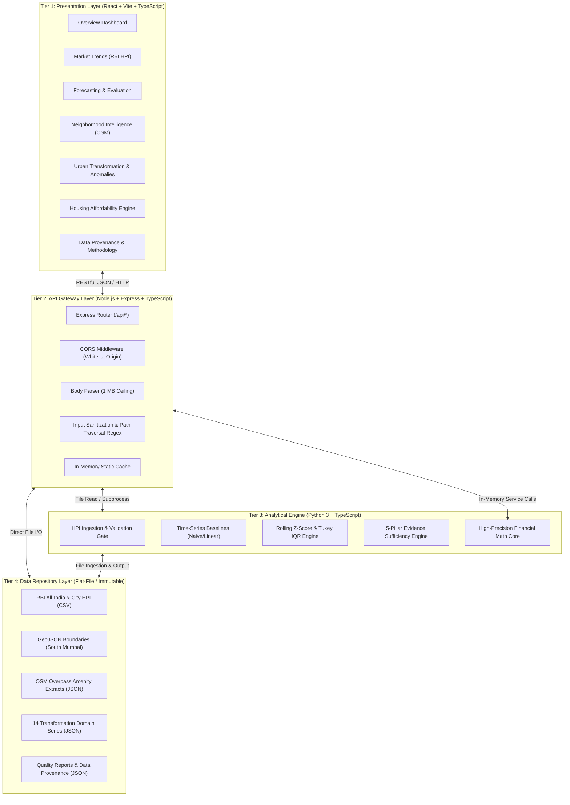
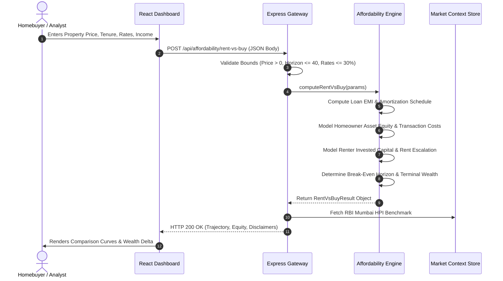

# UrbanLens — System Architecture & Engineering Design

**Project**: UrbanLens — Urban Market Intelligence & Housing Affordability Analytics Platform  
**Target Milestone**: Milestone 8 (Final Engineering & Submission)  
**Date**: November 2026  
**Status**: APPROVED ARCHITECTURE  

---

## 1. High-Level Architectural Overview

UrbanLens is structured as a decoupled, four-tier web application designed to achieve high computational throughput, zero commercial bias, and an ultra-lightweight hardware footprint suitable for local developer execution (e.g., MacBook Air M2, 8 GB RAM, 256 GB SSD) or containerless cloud deployment.

---

## 2. Detailed Tier Specifications

### 2.1 Tier 1: Presentation Layer
- **Framework**: React 18 with Vite build tooling and TypeScript.
- **Styling**: Tailwind CSS utilizing atomic utility classes for consistent typography, color tokens, and responsive grid layouts.
- **Data Visualization**: Recharts (SVG-based reactive line, bar, area, and composed charts) and React Leaflet (interactive OpenStreetMap vector tile rendering).
- **Optimization Strategy**:
  - Route-level code splitting using `React.lazy()` and React `<Suspense>` boundaries.
  - Dedicated Rollup vendor chunking:
    - `vendor.js`: Core runtime (`react`, `react-dom`, `react-router-dom`)
    - `charts.js`: Data visualization runtime (`recharts`)
    - `maps.js`: Geospatial rendering runtime (`leaflet`, `react-leaflet`)
  - All compiled page bundles are kept below 60 kB gzip.

### 2.2 Tier 2: API Gateway Layer
- **Server Runtime**: Node.js v20+ with Express v4 in strict TypeScript mode.
- **Security & Protection Stack**:
  - Strict Cross-Origin Resource Sharing (`cors`) locked to the designated frontend origin.
  - Strict payload ceiling: `express.json({ limit: '1mb' })`.
  - Comprehensive regex enforcement on route parameters (`/^[a-z0-9_-]{1,80}$/i`) preventing directory traversal attacks.
- **API Surface**: 28 structured REST endpoints grouped across 5 logical routers:
  1. `/api/health`
  2. `/api/data/*` (HPI observations, data sources, quality manifests)
  3. `/api/neighborhoods/*` (GeoJSON boundaries, OSM amenities, spatial analytics)
  4. `/api/forecasting/*` (Baseline models, metric evaluations, demo forecasts)
  5. `/api/transformation/*` (14-domain indicators, anomalies, evidence verdicts)
  6. `/api/affordability/*` (EMI, upfront costs, ownership, rent-vs-buy, FOIR)

### 2.3 Tier 3: Analytical & Financial Calculation Engine
- **Financial Calculation Core**:
  - Implemented in TypeScript (`server/src/services/affordabilityService.ts`) for sub-millisecond API response times.
  - Mirrored and verified by Python implementation (`server/python/affordability.py`) to guarantee multi-platform numerical equivalence.
  - Double-precision IEEE 754 floating-point mathematics without intermediate rounding truncation.
  - L'Hôpital boundary limit handling for zero-interest loan cases ($\lim_{r \to 0} \frac{P \cdot r}{1 - (1+r)^{-n}} = \frac{P}{n}$).
- **Transformation & Anomaly Engine**:
  - Python statistical modules (`server/python/transformation/`) computing rolling Z-scores and Tukey's interquartile range (IQR) anomalies across 60 quarters of data.
  - 5-Pillar Evidence Sufficiency Engine evaluating whether multi-indicator criteria are satisfied before rendering gentrification assessments.

### 2.4 Tier 4: Flat-File Data Repository Layer
- **Design Philosophy**: Completely eliminates dependencies on heavyweight database engines (PostgreSQL, MongoDB, or Redis) that would exhaust system RAM on 8 GB MacBook Air development hardware.
- **Storage Strategy**:
  - Time-series and index data stored as normalized CSVs (`data/real_data/`, `data/synthetic_data/`).
  - Spatial boundaries stored as RFC 7946 GeoJSON files (`data/neighborhoods/`).
  - Transformation indicators and quality metrics stored as structured JSON documents (`data/transformation/`).
  - Read-only during API execution; thread-safe, immutable, and version-controlled directly via Git.

---

## 3. Data Flow & Sequence Architecture

### 3.1 Affordability Simulation Flow

---

## 4. Error Handling & Fault Isolation

1. **Client-Side Fault Isolation**:
   - Every page component incorporates an `ApiErrorState` boundary with a user-friendly retry trigger, preventing network dropouts from crashing the entire application shell.
2. **Gateway-Level Error Handling**:
   - Centralized error handler catches unhandled exceptions, returning standard JSON error envelopes (`{ error: string, message: string }`) with appropriate HTTP status codes (400, 404, 500).
3. **Stateless Computation Isolation**:
   - User inputs for financial calculations are never written to disk or memory state caches, preventing state cross-contamination between concurrent requests.

---

## 5. Performance & Hardware Suitability

| System Component | Resource Footprint | Design Justification |
| :--- | :--- | :--- |
| Node.js API Server | ~45 MB RAM | Lightweight asynchronous event loop; zero background daemons |
| React Client Build | 850 kB Total JS (Split) | Gzip transfer weight ~260 kB; instantaneous page load |
| Data Storage | ~12 MB Disk | Flat-file CSV/JSON; zero database engine memory overhead |
| Total Execution Footprint | < 150 MB RAM | Leaves 7.85 GB RAM free on standard 8 GB M2 MacBook Air |
